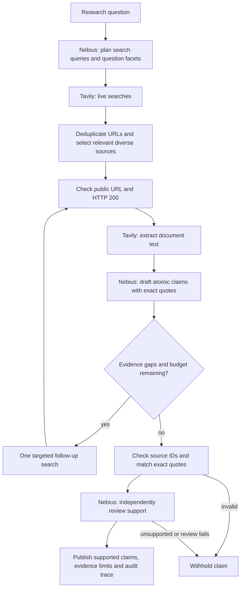

# EvidenceDesk

**A research brief with an evidence trail behind every published claim.**

Built by **Wang Yexiang** for the **ODSC × Nebius Hackathon — Build a Research Agent (2026)**.

EvidenceDesk helps university students start a coursework literature review: ask a focused question, search the live web, read selected documents, and inspect the original evidence behind each finding. It is a lightweight Python application; all model inference runs on Nebius Token Factory. No local models, vector database, JavaScript build system or agent framework are required.

> **Validation status:** The offline contract and citation tests pass. Live Token Factory/Tavily tests and the recorded demo are pending account activation and API keys. No example answer or live benchmark is fabricated. This notice will be updated only after real runs are recorded.

## Run locally

Python **3.11+** is required. The UI and CLI use the same research pipeline.

```bash
git clone https://github.com/Wwang1119/evidencedesk.git
cd evidencedesk
python3 -m venv .venv
source .venv/bin/activate
python -m pip install -e '.[dev]'
cp .env.example .env
# Open .env locally and fill in both API keys.
python -m evidencedesk models
# Set NEBIUS_MODEL in .env to an available chat model supporting JSON output.
python -m evidencedesk doctor
python -m evidencedesk serve
```

Open **http://127.0.0.1:8765**. Choose an example or enter your question, then select **Build research brief**. Click a numbered citation to inspect its quote, source context and original URL. Export Markdown for your notes or Audit JSON to inspect the research trace.

For the exact dependency versions used during development, install `requirements-lock.txt` before the editable install.

CLI alternative:

```bash
python -m evidencedesk ask \
  "For an undergraduate literature review, what benefits and limitations of retrieval-augmented generation are supported by the original RAG paper and recent research?" \
  --out .local/runs
```

The CLI prints a Markdown brief, with source links attached to claims. `--out` writes Markdown and JSON locally. Exit codes: `0` = at least one published claim, `2` = insufficient evidence, `1` = setup or provider error. A partial brief can have published claims and unresolved gaps.

## Required accounts and keys

| Variable | Obtain from | Purpose |
| --- | --- | --- |
| `NEBIUS_API_KEY` | [Nebius Token Factory](https://tokenfactory.nebius.com/) | Open-model planning, synthesis and support review |
| `NEBIUS_MODEL` | The live Token Factory model catalog (`models` command) | Exact chat model ID; must support JSON mode |
| `TAVILY_API_KEY` | [Tavily](https://app.tavily.com/) | Live web search and document extraction |

The example model is `meta-llama/Meta-Llama-3.1-8B-Instruct-fast`, shown in [Nebius' inference examples](https://nebius.com/services/token-factory/inference-service). Availability is account-dependent; verify against the live catalog. The [Nebius Builder Program](https://dev.nebius.com/builders) offers starter credits, subject to its eligibility and partner terms. LangSmith is optional and not required by this project.

**Put actual keys only in the local `.env`.** `.env`, virtual environments, recordings and `.local/` are ignored by Git. Never paste keys into the UI, screenshots, issues or public logs. The browser receives connection booleans, not credentials. `.env.example` contains empty placeholders. Restart the service after changing account setup; the local status endpoint also rereads settings. The shell's environment, if set, takes precedence over `.env`.

`doctor` makes one minimal logical call to each required service and reports its actual result. It never treats mocked tests or a model catalog response as successful inference.

## Architecture



The orchestrator is a small, bounded state machine in [`agent.py`](evidencedesk/agent.py). Nebius plans up to two complementary queries and named question facets. Tavily retrieves five results per query using advanced search. The application deduplicates tracking variants, caps each hostname at two candidates, and gives a modest, transparent preference to likely academic, government and documentation sources. This heuristic is **not a credibility score**.

Up to four initial documents are checked and extracted. A missing evidence facet can trigger one targeted follow-up query, with space for two more documents. Research stops at **three logical searches and six extracted documents**. Source text is normalized and capped at 14,000 characters per document to bound context and cost. This may omit relevant text, which can lead to abstention. Normally three model calls are made (plan, synthesize, review); a follow-up can add a second synthesis. A failed plan falls back to searching the original question, but an answer still requires real Nebius synthesis and support review.

Integrations are implemented as direct, readable REST calls in [`providers.py`](evidencedesk/providers.py):

- Nebius: `POST https://api.tokenfactory.nebius.com/v1/chat/completions`
- Tavily search: `POST https://api.tavily.com/search`
- Tavily extract: `POST https://api.tavily.com/extract`

Only those official service hosts receive their respective credentials. Requests have timeouts and one bounded retry for transient errors; retries can increase actual HTTP requests beyond logical call counts. No paid fallback provider or alternative inference service is used.

## How citations work

The model does not write the final citation URLs. It proposes structured claims referencing source IDs issued by the application.

1. **Reachability.** Public URLs are checked with a separate HTTP GET. Only HTTP 200 sources with sufficient Tavily-extracted text enter synthesis. Redirect targets are checked again. Failed, blocked and unextractable sources are excluded visibly.
2. **Identity and quote integrity.** Every citation must reference a known source, and its short quote must be a contiguous, case-sensitive match in that source's normalized extracted text. Fabricated quotations, unknown IDs and model-inserted URLs/citation numbers cause the whole claim to be withheld.
3. **Support review.** A separate Token Factory call sees each claim, its quote and surrounding context. It checks scope, dates, quantitative statements, causal strength and whether every citation supports the attributed claim. Missing, duplicate, negative or failed reviewer verdicts withhold the claim.
4. **Deterministic rendering.** The application attaches numbered links to the approved claims. The evidence desk displays the quote, surrounding context, original URL, final redirect URL, HTTP status, check time and SHA-256 of the normalized text that was supplied to the model. `inference` and `conflict` claims are labeled explicitly.

The JSON export includes claim-to-source mappings, review reasons, query/tool trace, model ID, service request IDs when supplied, token totals and timing. It excludes complete source documents and credentials. The hash identifies the retrieved text; it does **not** provide an independently archived copy or prove source authenticity. Markdown includes direct original-source links alongside the claims and an evidence appendix.

**Limits:** This is an auditable research aid, not a guarantee of truth. An HTTP 200 response does not detect every soft 404, paywall or changed page. Matching quotes do not prove entailment; the reviewer is a fallible model and currently uses the same configured model as the synthesizer. Search can miss opposing evidence, sources can be wrong, and extracted text can be incomplete. Reader inspection remains necessary. No unsupported factual introduction or uncited conclusion is added around the approved claims. The UI reports question-facet coverage, rather than a misleading percentage of “truth”.

## Failure handling and boundaries

- Empty searches cause one follow-up attempt, then a visible insufficient-evidence brief.
- Partial retrieval failure preserves usable evidence and displays the gap.
- Invalid synthesis JSON, authentication errors, credit errors and timeouts are reported without a prewritten replacement answer.
- A citation/support failure withholds the affected claim. If review fails, no candidate claim is published.
- Source content is passed as untrusted data, separate from trusted instructions. Retrieved content never executes code or requests additional tools.
- The server binds only to loopback, rejects cross-origin research requests, serves only its dedicated static folder and permits one research run at a time. Closing the streaming connection cancels its run.
- Public-URL checks reject private/reserved IPs, credential-bearing URLs and redirects to private hosts. DNS validation is best-effort and does not pin DNS; this local prototype is **not a hardened multi-tenant fetch service**. Do not expose it directly to the internet without authentication, egress controls and rate limits.
- Questions and selected evidence are sent to the configured service providers. Keep confidential coursework and personal information out of research prompts.

## Examples and demonstration

Three live question prompts are built into the UI and listed in [`examples/questions.json`](examples/questions.json): a RAG literature review, spaced retrieval practice, and a deliberately fictional premise that should produce an evidence gap. Search outcomes and wording vary over time.

See [`demo/README.md`](demo/README.md) for the 2–3 minute recording sequence. The demo should show a real search/inference trace, a cited answer, an original source opening, and an insufficient-evidence case. There is no hidden canned-answer mode.

## Test and reproduce

```bash
python -m pytest -q
python -m evidencedesk doctor
python scripts/live_eval.py
```

`pytest` uses clearly synthetic fixtures and mocked HTTP responses. It tests the wire contract and evidence gates without spending credits. It covers fabricated quotes, unknown citations, URL deduplication, unsafe redirects, unavailable sources, support-review rejection, empty results, provider errors and secret-free exports. **It is not a live quality evaluation.**

`live_eval.py` runs the three example questions against the actual APIs, saving results and a factual summary under ignored `.local/evaluation/`. Inspect the returned claims and original pages manually; the script does not invent an accuracy score. The live evaluation will incur API usage.

## Project layout

```text
evidencedesk/
  agent.py       # bounded research orchestration and Markdown rendering
  providers.py   # real Nebius and Tavily API requests
  evidence.py    # URL checks, source selection and quote integrity
  schemas.py     # typed model responses and exported brief
  server.py      # local streaming API
  __main__.py    # CLI, model catalog and connectivity probes
  web/           # lightweight HTML/CSS/JS research interface
tests/           # offline adversarial and contract tests
scripts/         # live evaluation and publication preflight
demo/            # recording script and handoff notes
```

## License and attribution

Code is MIT licensed. Retrieved source content remains the property of its authors and is linked for verification. The project uses [Nebius Token Factory](https://docs.tokenfactory.nebius.com/quickstart), [Tavily Search](https://docs.tavily.com/documentation/api-reference/endpoint/search) and [Tavily Extract](https://docs.tavily.com/documentation/api-reference/endpoint/extract). It is an independent hackathon entry, not an endorsement by a university or service provider.
